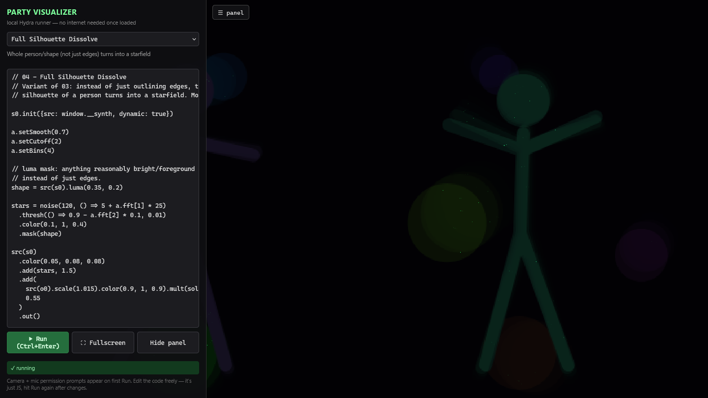
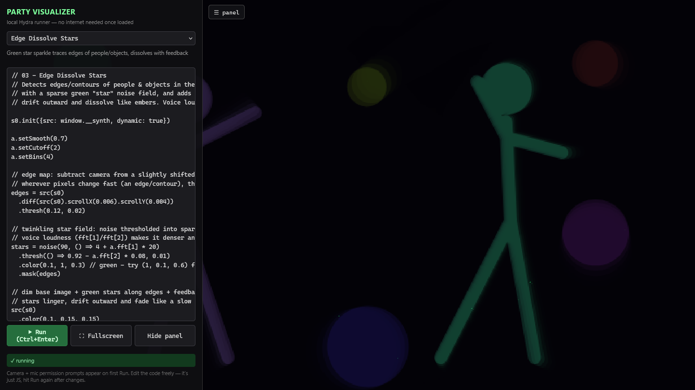
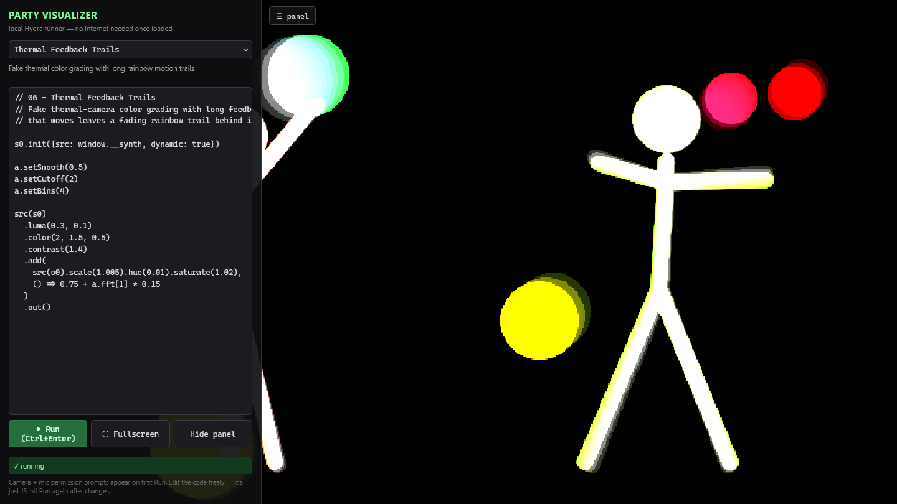

<div align="center">

# 🎉 Party Visualizer

**Turn a laptop, a webcam and a mic into live, music-reactive visuals for the projector. No internet needed at the party.**

[🌐 Landing page](https://itstomekk.github.io/party-visualizer/) · [▶️ Live demo](https://itstomekk.github.io/party-visualizer/app/) · [📖 Function reference](FUNCTION-REFERENCE.md) · [🛠 Development](DEVELOPMENT.md) · [🔄 Updating](UPDATING.md)



<sub>Screenshot: the real app running its own sketch, fed by a synthetic animated stand-in for the camera (so no real person is pictured).</sub>

</div>

> 💚 **Built on [Hydra](https://hydra.ojack.xyz) by [Olivia Jack](https://github.com/ojack).**
> Hydra is the open-source live-coding video synth that does all the heavy lifting here
> ([hydra-synth](https://github.com/ojack/hydra-synth), AGPL-3.0). This project is a small runner, a sketch library and an offline setup around it. Huge thanks to Olivia and the Hydra community.

## ✨ What is this?

A tiny local web app that runs [Hydra](https://hydra.ojack.xyz) sketches on your camera feed and reacts to your microphone: silhouettes dissolve into stars, kaleidoscopes pulse with the bass, motion leaves thermal rainbow trails. Pick a sketch, hit **Run**, go **Fullscreen**.

It is built for the "laptop → projector, flaky wifi" situation: the Hydra engine is vendored in the repo and the server uses only Node built-ins, so once you have the folder, it works **fully offline**.

## 🚀 Quick start (3 steps)

```bash
# 1. get the code
git clone https://github.com/itstomekk/party-visualizer.git
cd party-visualizer

# 2. start the server (needs Node.js; no npm install required to run)
node server.js

# 3. open http://localhost:8080 , click ▶ Run, allow camera + mic, press F for fullscreen
```

Port 8080 busy? Use `PORT=9000 node server.js` (PowerShell: `$env:PORT=9000; node server.js`).

## 🎛 What to try first

1. Start with **Camera Warp** (`01`): a safe, subtle starter that works in any light.
2. Switch to **Edge Dissolve Stars** (`03`) or **Full Silhouette Dissolve** (`04`) and talk or clap near the mic: the stars get denser.
3. **Audio Kaleidoscope** (`05`) reacts to bass; **Thermal Feedback Trails** (`06`) is great on a dance floor.
4. Edit the code in the left panel and press **Ctrl+Enter** to re-run without reloading the camera. The numbers are the dials.
5. Shortcuts: **Ctrl+H** hides the panel, **F** goes fullscreen.

| | |
|---|---|
|  |  |
| Edge Dissolve Stars | Thermal Feedback Trails |

## 🧩 Sketch library

| File | Effect |
|---|---|
| `01-camera-warp.js` | Basic distorted, pulsing, color-shifted camera feed. Safe starter. |
| `02-voice-reactive.js` | Same warp, but zoom + glitch pulse with mic input (voice range). |
| `03-dissolve-stars.js` | Green sparkle traces edges of people/objects, dissolves outward via feedback. Voice-reactive. |
| `04-silhouette-stars.js` | Like 03 but the whole silhouette (not just edges) turns to stars. More dramatic. |
| `05-kaleidoscope.js` | Mirrored kaleidoscope pattern; bass volume drives segment count. |
| `06-thermal-feedback.js` | Fake thermal color grading with long motion trails. |

Each sketch is plain JavaScript in Hydra's chained syntax with a comment header saying what to tweak. New to Hydra? The [FUNCTION-REFERENCE.md](FUNCTION-REFERENCE.md) cheat sheet explains every function used.

## ⚠️ Honest limits

- **Needs a modern browser with WebGL.** Chrome/Edge are the best-supported. The sketches ran in Firefox in my testing (with a simulated camera/mic); Safari is untested.
- **Camera and mic permission is required** for the camera/audio effects. Browsers only allow it on `http://localhost` or `https://`, never on a `file://` page, which is why there is a tiny server.
- **It wants a real GPU.** Hydra renders on the GPU; very old laptops or software-only rendering will be slow. The feedback sketches (03, 04, 06) are the heaviest.
- Sketch `02` shows a debug audio meter (`a.show()`): delete that line before the real event.
- A laptop-and-projector tool: no touch or mobile controls.
- The online [live demo](https://itstomekk.github.io/party-visualizer/app/) is the same app served statically; it also asks for camera/mic and everything is processed **in your browser** (nothing is uploaded).

## 🔭 Other tools in this space

- [hydra.ojack.xyz](https://hydra.ojack.xyz): the original online editor, with a [public gallery](https://hydra.ojack.xyz/garden/) of sketches to remix.
- [ojack/hydra-examples](https://github.com/ojack/hydra-examples) and [hydra-workshop](https://github.com/zachkrall/hydra-workshop): more example code.
- [fosfora](https://github.com/kevinraymond/fosfora): point-and-click open-source desktop VJ app, if live-coding isn't your thing.
- [triode](https://github.com/kasparsj/triode): Hydra-compatible, Three.js/3D powered.
- KodeLife and TouchDesigner: heavier native tools with a steeper learning curve.

## 📜 License

Licensed under the **GNU Affero General Public License v3.0** ([LICENSE](LICENSE)), because this repo redistributes Hydra's AGPL-3.0 engine. Third-party notices: [vendor/THIRD-PARTY-NOTICES.md](vendor/THIRD-PARTY-NOTICES.md). Reasoning in [DEVELOPMENT.md](DEVELOPMENT.md#licensing).

Hydra © Olivia Jack and contributors. Runner, server and sketches © 2026 itstomekk.
